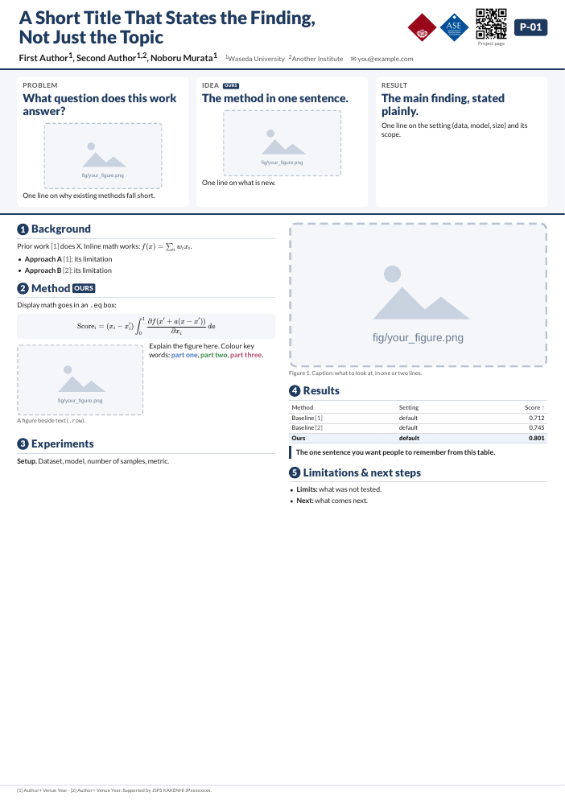
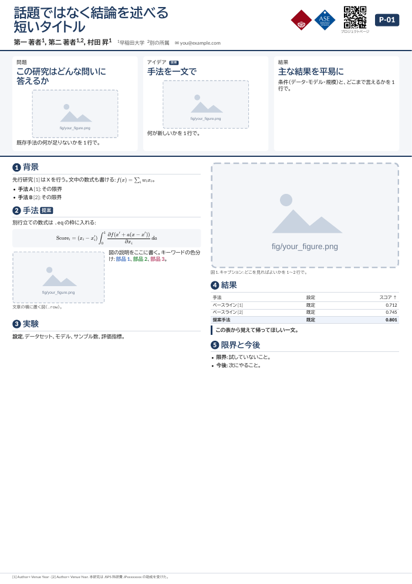
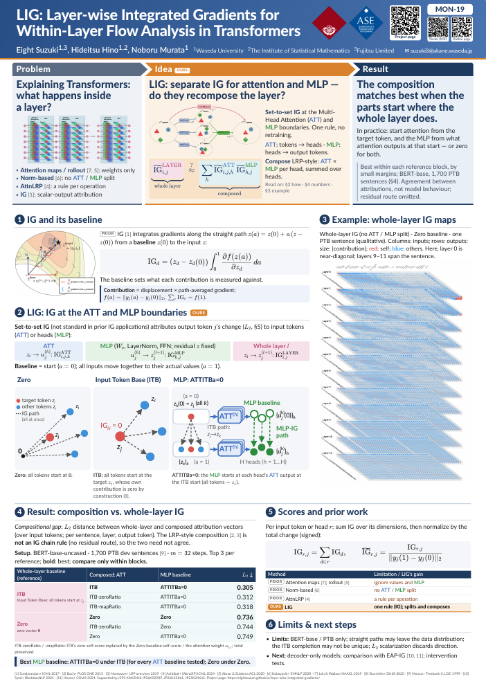

# poster-template

学会ポスターを HTML で書き、ヘッドレス Chrome で 1 枚の PDF に出力するためのテンプレートです。

- `make watch` を起動しておけば、HTML を保存するたびに PDF が作り直されます。
- 内容が紙に収まらないと、ターミナルに警告が出て、PDF の上端に赤い帯が付きます。
- 数式（KaTeX）と QR コードはそのまま書けます。
- 印刷所に断られやすい Type 3 フォントが入っていないかを `make check` で確かめられます。

  

左 2 枚が雛形（英語・日本語）、右が使用例（ICONIP 2026）です。

## はじめかた

```bash
git clone https://github.com/murata-lab/poster-template.git
cd poster-template
make setup                 # 初回だけ。PDF 出力用の Chrome を入れる（sudo 不要）
make new NAME=jsai2027     # posters/_template を posters/jsai2027 にコピー
cd posters/jsai2027
make watch                 # 保存するたびに poster_en.pdf / poster_ja.pdf を作り直す
```

あとは `poster_en.html`（または `poster_ja.html`）を書き換え、できた PDF を開いたままにしておきます。PDF ビューアで再読み込みすると変更が反映されます。VS Code ならタブで開いた PDF が自動で更新されます。

英語版と日本語版のどちらか一方しか要らないときは、使わない方の HTML を消してください。`make` は残っている `poster_*.html` だけを PDF にします。

## コマンド

ポスターのフォルダ（`posters/<名前>/`）で使うもの:

| コマンド | すること |
|---|---|
| `make` | すべての `poster_*.html` を PDF にする（プレビュー画像 `*_preview.png` も作る） |
| `make en` / `make ja` | 英語版だけ / 日本語版だけを作る |
| `make watch` | 保存のたびに作り直す（Ctrl-C で止める） |
| `make check` | Type 3 フォントが入っていないか確かめる（入稿前に必ず実行） |
| `make clean` | 作った PDF とプレビュー画像を消す |

リポジトリの一番上で使うもの:

| コマンド | すること |
|---|---|
| `make` | ヘルプを表示する |
| `make new NAME=<名前>` | 雛形から新しいポスターを作る |
| `make watch P=<名前>` | `cd posters/<名前> && make watch` と同じ |
| `make all` | すべてのポスターを作る |
| `make setup` | PDF 出力用のヘッドレス Chrome を入れる |
| `make doctor` | 必要なツールがそろっているか確かめる |

## 必要なもの

- **Chrome / Chromium**: `make setup` で入ります。Node.js（`npx`）、uv（`uvx`）、`pip install playwright` のどれか 1 つがあれば動きます。Google Chrome がすでに入っていれば、それを自動で使います。別の Chrome を使うときは `CHROME=/path/to/chrome make` と指定してください。
- **poppler**（なくても可）: プレビュー画像の作成、はみ出しの検出、`make check` に使います。入れ方は `sudo apt install poppler-utils`（Ubuntu）または `brew install poppler`（Mac）です。
- **インターネット接続**: フォント（Google Fonts）、KaTeX、QR コードのライブラリを CDN から読み込みます。

`make doctor` を実行すると、何が足りないかがわかります。

## 書き方

### 構成

雛形は上から順に、次の 4 つでできています。

1. **ヘッダー**: タイトル、著者、ロゴ、QR コード、ポスター番号
2. **帯**: Problem / Idea / Result の 3 枚のカード
3. **本文**: 2 段組みの節
4. **フッター**: 参考文献、謝辞

帯は「1 分で読める版」です。帯だけを読んだ人にも主張が伝わるように書き、細かい内容は本文に回します。各カードには見出し 1 つ、図 1 枚、補足 1 行を置く程度にとどめます。

雛形は中身を短くしてあるので、作ったばかりの PDF は下の方が空いています。内容を書き足せば埋まります。

### 部品

| 書きたいもの | 書き方 |
|---|---|
| 数式 | 文中は `$...$`、別行立ては `<div class="eq">$$...$$</div>`。`$` そのものを書きたい要素には `class="nomath"` を付ける |
| 図 | 画像を `fig/` に置き、`<figure><figcaption>…</figcaption></figure>` と書く。ファイル名に空白を入れない |
| 図と文章を横に並べる | `<div class="row"><figure>…</figure><div>…</div></div>` |
| QR コード | `<figure class="qr"><div data-qr="https://…"></div><figcaption>…</figcaption></figure>` |
| 強調したい一文 | `<p class="key">…</p>` |
| 表の最良の行 | `<tr class="best">` |
| 色分けした語 | `<span class="c1">`、`c2`、`c3`（色は `poster.css` の `:root` で変える） |
| 提案 / 先行研究のタグ | `<span class="tag ours">OURS</span>`、`<span class="tag prior">PRIOR</span>` |

### 紙のサイズ・色・文字の大きさ

- 色と紙のサイズは `poster.css` の冒頭でまとめて変えられます。
- 既定は A1 縦（594 × 841 mm）です。A0 にするときは、`@page` の行と `--w` / `--h` の両方を 841mm × 1189mm に書き換え、文字の大きさ（pt）を 1.4 倍前後に上げてください。
- 本文の文字の大きさは `body { font-size: … }` で変えます。

### はみ出したとき

`make` が `WARNING: ... overflows` と表示し、PDF の上端に赤い帯が出ます。帯には、はみ出した要素の名前と先頭の文字列が書かれています。文章を削るか、文字や図を小さくしてください。紙からはみ出した部分は、2 ページ目に回るのではなく切り落とされます。

### 印刷に出す前に

- `make check` を実行し、Type 3 フォントが入っていないことを確かめてください。印刷所（特に布ポスター）では Type 3 フォントが断られることがあります。
- 雛形のフォント（Lato と BIZ UDPゴシック）は静的な TrueType なので問題ありません。
- フォントを変えるときは、可変フォント（Inter など）や CFF 形式のフォント（ローカルの Noto Sans CJK など）を避けてください。どちらも Type 3 として埋め込まれます。

### 英語版と日本語版を両方作るとき

片方を原本と決め、そちらを先に直してからもう一方に反映すると食い違いが起きにくくなります。デザイン（`poster.css`）は 2 つで共通です。日本語版だけ文字の大きさなどを変えたいときは、`html[lang="ja"] …` のセレクタで上書きしてください。

## フォルダ構成

```
Makefile              リポジトリ全体の操作（new / setup / doctor / all）
tools/
  poster.mk           ビルドのルール（各ポスターの Makefile はこれを include するだけ）
  build.sh            HTML → PDF、プレビュー画像、はみ出しの検出
  find-chrome.sh      使える Chrome を探す
posters/
  _template/          雛形（make new はこれをコピーする）
  iconip2026-lig/     使用例: ICONIP 2026 のポスター（A1、英語・日本語）
```

`posters/iconip2026-lig/` は実際に使ったポスターです。図と文章を横に並べる配置、SVG で描いた図、複数の QR コード、表の作り方などを参考にしてください。このポスターは Lato をローカルにインストールされたフォントから読み込んでいます。Lato が入っていない環境では、別のフォントで表示されます。
